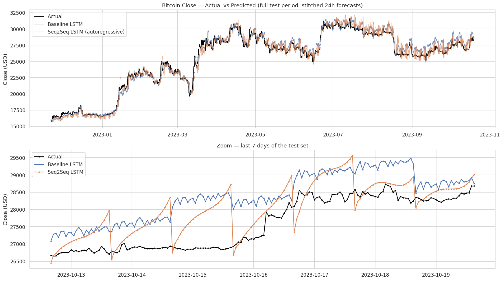
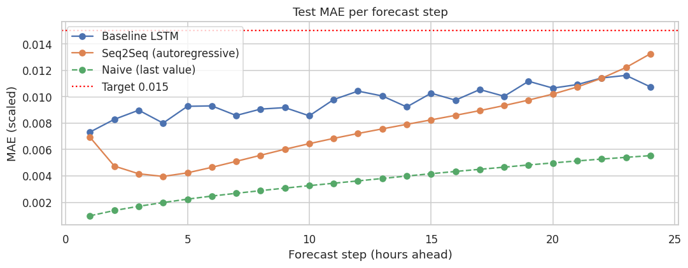
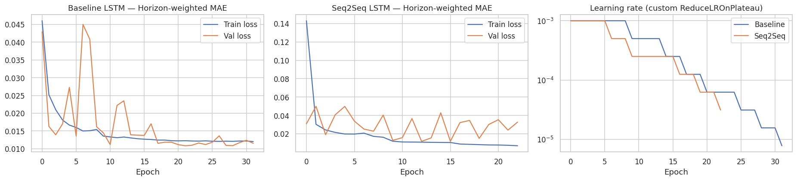

# Bitcoin 24-Hour Forecasting — Seq2Seq LSTM dengan Custom Layer & Custom Training Loop


Proyek akhir *advanced deep learning* untuk memprediksi harga penutupan (**Close**) Bitcoin **24 jam ke depan** (multi-horizon / multi-step) dari data per jam. Seluruh komponen penting dibangun secara manual: **custom layer** (Dense, Multi-Head Attention, Layer Normalization, Dropout), model **Seq2Seq LSTM dengan Teacher Forcing** (Model Subclassing), **custom loss** berbobot horizon, **custom callback** (Early Stopping dan ReduceLROnPlateau), serta **custom training loop** dengan `tf.GradientTape`.

---

## Daftar Isi

1. [Ringkasan](#ringkasan)
2. [Fitur Utama](#fitur-utama)
3. [Dataset](#dataset)
4. [Struktur Repository](#struktur-repository)
5. [Alur Proyek](#alur-proyek)
6. [Tahapan Detail](#tahapan-detail)
7. [Arsitektur Model](#arsitektur-model)
8. [Konfigurasi & Hyperparameter](#konfigurasi--hyperparameter)
9. [Hasil](#hasil)
10. [Requirements & Instalasi](#requirements--instalasi)
11. [Cara Menjalankan](#cara-menjalankan)
12. [Memuat Model yang Sudah Disimpan](#memuat-model-yang-sudah-disimpan)
13. [Catatan Penting](#catatan-penting)
14. [Keterbatasan & Pengembangan Lanjutan](#keterbatasan--pengembangan-lanjutan)
15. [Lisensi & Kontak](#lisensi--kontak)

---

## Ringkasan

| Item | Keterangan |
|---|---|
| Tugas | Multivariate multi-step time series forecasting |
| Target | `Close` Bitcoin (USD), **24 langkah / 24 jam** ke depan |
| Data | Bitcoin per jam, 2017-09-21 sampai 2023-10-19 (~53.152 baris) |
| Window input | **48 jam** (ditentukan dari analisis PACF) |
| Jumlah fitur | **9** (6 fitur dasar + 3 fitur rolling statistic) |
| Model 1 | Baseline LSTM (Functional API) + custom layer |
| Model 2 | Seq2Seq LSTM, Teacher Forcing (Model Subclassing) + custom layer |
| Inference Seq2Seq | **Autoregressive** (tanpa ground truth) |
| Metrik utama | MAE pada data test, skala ternormalisasi (sebelum inverse scaling), target **< 0,015** |
| Platform | Kaggle Notebook (GPU) |

## Fitur Utama

- **Tanpa data leakage**: split kronologis dilakukan *sebelum* scaling, `MinMaxScaler` hanya di-*fit* pada data train, dan ada *assertion* untuk memverifikasinya.
- **EDA lengkap**: heatmap korelasi, dekomposisi target, serta plot ACF/PACF untuk menentukan window size.
- **Feature engineering** dengan *rolling statistics* (mean dan std 24 jam).
- **Pipeline `tf.data`** berbasis indeks (hemat memori) dengan `shuffle`, `AUTOTUNE`, dan `prefetch`, dibagi menjadi train, validation, dan test.
- **Custom layer dari nol**: `CustomDense`, `CustomMultiHeadAttention`, `CustomLayerNormalization`, `CustomDropout` (semua mendukung serialisasi `.keras`).
- **Custom loss**: MAE berbobot horizon, step yang lebih jauh punya bobot lebih besar.
- **Custom callback**: `CustomEarlyStopping` dan `CustomReduceLROnPlateau`.
- **Custom training loop** `tf.GradientTape` dengan *gradient clipping* dan `tf.function`.
- **Evaluasi jujur** untuk Seq2Seq: decoding autoregressive, dan validasi (untuk pemilihan model terbaik) juga autoregressive.

## Dataset

- **Nama**: *Multivariate Crypto Data Hourly since 2017 to 2023* (Kaggle). Pada proyek ini hanya data **Bitcoin** yang digunakan.
- **Sumber**: `<tautan dataset Kaggle>` &larr; isi dengan URL dataset yang Anda gunakan.
- **Kolom**:

| Kolom | Deskripsi |
|---|---|
| `Date` | Timestamp per jam |
| `Close` | Harga penutupan BTC/USDT, **target prediksi** |
| `Volume USDT` | Volume transaksi (di-*log1p* pada preprocessing) |
| `RSI` | Relative Strength Index |
| `MACD_Hist` | Histogram MACD |
| `ATR` | Average True Range |
| `KAMAO` | Indikator berbasis Kaufman Adaptive Moving Average |

**Fitur tambahan (rolling statistic, window 24 jam)**: `Close_roll_mean_24`, `Close_roll_std_24`, `Volume_roll_mean_24`.

> Dataset tidak disertakan di repository ini. Tambahkan dataset ke Kaggle Notebook melalui *Add Input*.

## Struktur Repository

```text
.
├── Nama_Submission_Akhir_DLTM.ipynb     # Notebook utama (sudah dijalankan, output tersimpan)
├── model_baseline_LSTM.keras            # Model 1: Baseline LSTM
├── model_seq2seq_LSTM.keras             # Model 2: Seq2Seq LSTM (bobot epoch terakhir)
├── best_model_seq2seq_LSTM.keras        # Model 2: Seq2Seq LSTM (bobot validasi terbaik)
├── requirements.txt                     # Dependensi
├── assets/                              # (opsional) gambar plot untuk README
└── README.md
```

## Alur Proyek

```mermaid
flowchart LR
    A[Load & Cleaning] --> B[EDA & Feature Engineering]
    B --> C[Split Kronologis 70/15/15]
    C --> D[Dekomposisi & ACF/PACF<br/>window = 48]
    D --> E[Scaling train-only]
    E --> F[tf.data Windowing]
    F --> G[Custom Layers & Model]
    G --> H[Custom Training Loop<br/>GradientTape]
    H --> I[Inference Autoregressive<br/>& Evaluasi MAE]
    I --> J[Simpan .keras]
```



## Tahapan Detail

### Tahap 1 — Persiapan Data

1. **Konfigurasi GPU Kaggle**: deteksi GPU, *memory growth*, dan seed untuk reproduktibilitas.
2. **Loading & cleaning**: parsing tanggal, urut kronologis, hapus duplikat, cek kontinuitas per jam (celah ≤ 6 jam diinterpolasi), pastikan tidak ada NaN.
3. **EDA**: plot setiap fitur sepanjang waktu dan **heatmap korelasi** (fitur dasar, lalu fitur dasar + rolling).
4. **Feature engineering**: `log1p` pada volume (transformasi tanpa parameter yang dipelajari, sehingga tidak menyebabkan leakage) dan tiga *rolling statistic* trailing 24 jam (hanya memakai data masa lalu).
5. **Split kronologis 70% / 15% / 15%** (train / validation / test), dilakukan sebelum scaling.
6. **Dekomposisi target** (`seasonal_decompose`, additive, periode 24 jam): observed, trend, seasonal, residual, beserta kekuatan trend dan seasonal.
7. **Analisis ACF & PACF** pada data train (level dan selisih pertama). Window size dipilih dari lag PACF signifikan terakhir (maks. 48), dibulatkan ke kelipatan 24 &rarr; **`WINDOW_SIZE = 48`**.
8. **Scaling tanpa leakage**: `MinMaxScaler` di-*fit* hanya pada data train, lalu `transform` pada validation dan test. Tersedia fungsi `inverse_close()` untuk mengembalikan ke USD.
9. **Pipeline `tf.data`**: setiap sampel berbentuk `((encoder_input, decoder_input), target)`:
   - `encoder_input` : `(48, 9)`, window historis semua fitur
   - `decoder_input` : `(24, 1)`, input *teacher forcing* = `[Close terakhir, y1, ..., y23]`
   - `target` : `(24, 1)`, 24 nilai Close berikutnya

   Window validation dan test diawali konteks dari split sebelumnya sebagai **input saja**, sehingga seluruh *target* tetap berada di dalam split masing-masing.

### Tahap 2 — Arsitektur Kustom

- Empat custom layer dari nol (lihat [Arsitektur Model](#arsitektur-model)).
- Model 1 (Functional API) dan Model 2 (Model Subclassing).
- Pemeriksaan: *dummy forward pass* (bentuk output `(B, 24, 1)`), pemeriksaan aliran gradient ke semua bobot, serta uji *save/load* `.keras` dengan selisih prediksi 0.

### Tahap 3 — Pelatihan Kustom

- **Custom loss** `HorizonWeightedMAE`: bobot step *t* = `1.0 + 0.1·t` (1,0 untuk step 1 sampai 3,3 untuk step 24), dinormalisasi agar rata-rata bobot = 1.
- **`CustomEarlyStopping`**: berhenti jika `val_loss` tidak membaik selama `patience` epoch, menyimpan bobot terbaik.
- **`CustomReduceLROnPlateau`**: learning rate dikali `factor` saat `val_loss` stagnan.
- **Training loop `tf.GradientTape`** untuk kedua model; setiap epoch mencetak `Epoch`, `loss`, `val_loss`, `lr`, dan waktu.
- Seq2Seq dilatih dengan *teacher forcing*; validasi memakai decoding **autoregressive** (dapat diganti lewat `SEQ2SEQ_VAL_MODE`).

### Tahap 4 — Inference, Evaluasi & Penyimpanan

- Baseline LSTM: prediksi langsung 24 langkah.
- Seq2Seq LSTM: `autoregressive_predict()`, setiap prediksi menjadi input decoder berikutnya.
- Metrik: MAE dan RMSE (skala ternormalisasi), MAE, RMSE dan MAPE (USD), serta pembanding naif *persistence* (mengulang Close terakhir).
- Visualisasi: line chart prediksi vs aktual untuk 24 jam ke depan, grafik prediksi sepanjang periode test, dan MAE per langkah prediksi.
- Tabel perbandingan dengan kolom **`Jam ke | Data Aktual | Hasil Prediksi | Selisih`** (24 baris).
- Penyimpanan tiga model `.keras` dan pembuatan `requirements.txt`.

## Arsitektur Model

### Custom Layer

| Layer | Deskripsi |
|---|---|
| `CustomDense` | `y = activation(xW + b)` dengan `einsum`, mendukung input 2D dan 3D |
| `CustomMultiHeadAttention` | Proyeksi Q/K/V per head, *scaled dot-product attention* (`softmax(QKᵀ/√d)`), concat head, proyeksi output `Wo`; mendukung self/cross-attention dan causal mask |
| `CustomLayerNormalization` | Normalisasi pada sumbu fitur dengan `gamma` dan `beta` yang dapat dilatih |
| `CustomDropout` | Inverted dropout (aktif hanya saat training) |

Semuanya diwariskan dari `keras.layers.Layer`, memiliki `build`, `call`, dan `get_config`, serta didaftarkan dengan `register_keras_serializable(package="CustomTS")`.

### Model 1 — Baseline LSTM (Functional API)

```text
Input (48, 9)
 → LSTM(128, return_sequences) → CustomLayerNorm
 → CustomMultiHeadAttention (self-attention) + Residual → CustomLayerNorm → CustomDropout
 → LSTM(128) → CustomDense(128, ReLU) → CustomDropout
 → CustomDense(24) → Reshape (24, 1)
```

### Model 2 — Seq2Seq LSTM, Teacher Forcing (Model Subclassing)

```text
Encoder : LSTM(128, return_sequences, return_state) → CustomLayerNorm  → (enc_seq, h, c)
Decoder : LSTM(128, return_sequences) dengan initial_state = (h, c)
          ← input decoder (24, 1)  [teacher forcing saat training]
Attention: CustomMultiHeadAttention (cross-attention: query = decoder, key/value = enc_seq)
Head    : CustomLayerNorm(dec + context) → CustomDropout → CustomDense(128, ReLU) → CustomDense(1)
Output  : (B, 24, 1)
```

Saat inference, `autoregressive_predict()` memulai dari Close terakhir yang diketahui, lalu memakai prediksi sebelumnya sebagai input langkah berikutnya sebanyak 24 kali.

## Konfigurasi & Hyperparameter

| Parameter | Nilai |
|---|---|
| Horizon / Window | 24 / 48 |
| Split | 70% / 15% / 15% (kronologis) |
| LSTM units | 128 |
| Attention | 4 head × `key_dim` 32 |
| Dropout | 0,1 |
| Optimizer | Adam, `lr = 1e-3` |
| Gradient clipping | global norm 1,0 |
| Batch size | 256 (train), 512 (validation/test) |
| Epoch maksimum | 60 |
| Early stopping | `patience = 10`, `min_delta = 1e-5` |
| ReduceLROnPlateau | `factor = 0,5`, `patience = 3`, `min_lr = 1e-6` |
| Loss | MAE berbobot horizon (`1.0 + 0.1·t`, dinormalisasi) |
| Seed | 42 |

> Sesuaikan tabel ini jika Anda mengubah nilai di notebook.

## Hasil

> **Isi bagian ini dengan angka dari output notebook Anda.** Nilai di bawah sengaja dikosongkan.

### Metrik pada data test

| Model | MAE (scaled) | RMSE (scaled) | MAE (USD) | RMSE (USD) | MAPE (%) |
|---|---|---|---|---|---|
| Naive (last value), referensi | _0.00971_ | _0.01225_ | _635.87_ | _801.91_ | _2.448_ |
| Baseline LSTM | _0.00360_ | _0.00603_ | _235.61_ | _394.71_ | _0.932_ |
| Seq2Seq LSTM (epoch terakhir, autoregressive) | _0.01822_ | _0.02169_ | _1,192.80_ | _1,420.15_ | _4.749_ |
| Seq2Seq LSTM (validasi terbaik, autoregressive) | _0.00767_ | _0.01041_ | _501.89_ | _681.62_ | _1.980_ |

Target kriteria: **MAE test (scaled) < 0,015** &rarr; status: _lulus / belum lulus_

#### [PASS] Baseline LSTM : test MAE (scaled) = 0.00971  (target < 0.015)
#### [FAIL] Seq2Seq final : test MAE (scaled) = 0.01822  (target < 0.015)
#### [PASS] Seq2Seq best  : test MAE (scaled) = 0.00767  (target < 0.015)

### Visualisasi

<!-- Simpan gambar dari notebook ke folder assets/ lalu hilangkan komentar pada baris berikut -->
<!--  -->
<!--  -->
<!--  -->
<!--  -->

### Contoh tabel perbandingan (24 jam ke depan)

### Hasil Prediksi 24 Jam ke Depan: Seq2Seq LSTM vs Baseline LSTM

| Jam ke | Data Aktual | Prediksi Seq2Seq | Selisih Seq2Seq | Prediksi Baseline | Selisih Baseline |
|---:|---:|---:|---:|---:|---:|
| 1 | 16032.24 | 15654.482129 | 377.757417 | 15841.373348 | 190.866197 |
| 2 | 16015.22 | 15776.624633 | 238.595183 | 15830.441430 | 184.778385 |
| 3 | 15971.36 | 15835.670842 | 135.689616 | 15750.232737 | 221.127720 |
| 4 | 15722.98 | 15858.578414 | -135.598899 | 15808.384454 | -85.404939 |
| 5 | 15785.27 | 15860.860977 | -75.590892 | 15753.889716 | 31.380370 |
| 6 | 15649.52 | 15853.076851 | -203.556859 | 15862.145651 | -212.625659 |
| 7 | 15740.27 | 15840.427158 | -100.156737 | 15832.012888 | -91.742466 |
| 8 | 15781.29 | 15825.354435 | -44.064204 | 15924.123100 | -142.832869 |
| 9 | 15866.48 | 15809.204812 | 57.274783 | 15835.032895 | 31.446701 |
| 10 | 15812.06 | 15792.852293 | 19.207674 | 15931.870160 | -119.810193 |
| 11 | 15900.14 | 15777.038226 | 123.101376 | 15871.530498 | 28.609104 |
| 12 | 15847.82 | 15762.578089 | 85.242038 | 15864.476012 | -16.655885 |
| 13 | 15822.79 | 15750.330283 | 72.459683 | 15875.268440 | -52.478474 |
| 14 | 15803.90 | 15741.274164 | 62.626127 | 15971.134152 | -167.233862 |
| 15 | 15687.47 | 15736.311051 | -48.841004 | 15818.965209 | -131.495162 |
| 16 | 15760.42 | 15736.420302 | 24.000081 | 15881.523054 | -121.102670 |
| 17 | 15729.98 | 15742.468120 | -12.487768 | 15973.375746 | -243.395394 |
| 18 | 15687.97 | 15755.230966 | -67.260511 | 15987.382297 | -299.411842 |
| 19 | 15797.30 | 15775.364346 | 21.936020 | 15896.453359 | -99.152994 |
| 20 | 15747.88 | 15803.398907 | -55.518965 | 15972.480279 | -224.600338 |
| 21 | 15836.41 | 15839.732634 | -3.322398 | 16008.115581 | -171.705345 |
| 22 | 16171.01 | 15884.634753 | 286.374893 | 15974.357054 | 196.652593 |
| 23 | 16117.28 | 15938.234024 | 179.045640 | 15905.937703 | 211.341961 |
| 24 | 16241.30 | 16000.538251 | 240.761667 | 15906.537608 | 334.762311 |


`Selisih = Data Aktual − Hasil Prediksi`

## Requirements & Instalasi

**Lingkungan yang digunakan**: Kaggle Notebook dengan akselerator GPU (mis. T4/P100), Python 3.10+.

**Library utama** (versi lengkap ada di `requirements.txt`):

| Library | Kegunaan |
|---|---|
| `tensorflow` / `keras` (≥ 2.16 / Keras 3) | Model, custom layer, training loop |
| `numpy`, `pandas` | Pengolahan data |
| `scikit-learn` | `MinMaxScaler` |
| `statsmodels` | Dekomposisi, ACF, PACF |
| `matplotlib`, `seaborn` | Visualisasi |
| `joblib` | Menyimpan scaler |

Instalasi lokal:

```bash
git clone https://github.com/<username>/<nama-repo>.git
cd <nama-repo>
python -m venv .venv
source .venv/bin/activate        # Windows: .venv\Scripts\activate
pip install -r requirements.txt
```

> Pelatihan memakai LSTM dan loop autoregressive, jadi disarankan menggunakan GPU. Di CPU, proses akan jauh lebih lambat.

## Cara Menjalankan

**Di Kaggle (disarankan)**

1. Buat notebook baru, lalu **Add Input** dan pilih dataset *Multivariate Crypto Data Hourly since 2017 to 2023*.
2. Pada *Settings*, aktifkan **Accelerator &rarr; GPU**.
3. Unggah/salin sel notebook `Nama_Submission_Akhir_DLTM.ipynb`.
4. Jalankan seluruh sel secara berurutan (*Run All*). Dataset akan dicari otomatis di `/kaggle/input`; jika gagal, isi `DATA_PATH` secara manual.
5. File keluaran (`.keras`, `requirements.txt`, `scaler.pkl`, CSV tabel) tersimpan di `/kaggle/working/`.

**Secara lokal**

1. Unduh dataset dan letakkan CSV di folder proyek (atau set `DATA_PATH`).
2. Buka notebook dengan Jupyter dan jalankan semua sel secara berurutan.

## Memuat Model yang Sudah Disimpan

Custom layer didaftarkan dengan `register_keras_serializable`, sehingga **definisi kelasnya harus sudah dijalankan** (sel custom layer pada notebook, atau diimpor dari file `.py`) sebelum memanggil `load_model`.

```python
import keras

# jalankan dulu sel definisi CustomDense, CustomMultiHeadAttention,
# CustomLayerNormalization, CustomDropout, dan Seq2SeqLSTM

baseline = keras.models.load_model("model_baseline_LSTM.keras")
seq2seq = keras.models.load_model("best_model_seq2seq_LSTM.keras")

# x: array float32 berbentuk (batch, 48, 9), sudah di-scale dengan scaler train
pred_baseline = baseline(x, training=False)            # (batch, 24, 1)
pred_seq2seq = seq2seq.autoregressive_predict(x)       # (batch, 24, 1)

# kembalikan ke USD dengan statistik scaler dari data train (kolom Close = indeks 0)
close_usd = pred_seq2seq.numpy() * scaler.data_range_[0] + scaler.data_min_[0]
```

## Catatan Penting

- **Urutan fitur harus sama** saat inference (`Close` di indeks 0, lalu `Volume_USDT`, `RSI`, `MACD_Hist`, `ATR`, `KAMAO`, dan tiga fitur rolling) dan harus memakai scaler yang di-fit pada data train.
- **MAE target (< 0,015) dihitung pada skala ternormalisasi**, sebelum inverse scaling. Nilai dalam USD dilaporkan terpisah.
- **Dua file Seq2Seq berbeda**: `model_seq2seq_LSTM.keras` berisi bobot epoch terakhir, sedangkan `best_model_seq2seq_LSTM.keras` berisi bobot dengan validation loss terbaik. Keduanya dievaluasi, dan visualisasi memakai model terbaik hasil seleksi validasi (bukan test).
- **Teacher forcing hanya saat training**. Evaluasi test memakai autoregressive, sehingga tidak ada kebocoran ground truth.
- **Validasi autoregressive** (default) membuat pemilihan epoch terbaik mencerminkan performa nyata saat deployment. Ubah `SEQ2SEQ_VAL_MODE = "teacher_forcing"` bila ingin validasi lebih cepat.
- **Reproduktibilitas**: seed diatur ke 42, tetapi operasi GPU (cuDNN LSTM) dapat menghasilkan variasi kecil antar-run.
- **Tidak memakai AutoML**; seluruh model dan proses pelatihan ditulis manual.
- Jalankan notebook penuh sebelum diserahkan agar semua output sel tersimpan.

## Keterbatasan & Pengembangan Lanjutan

- Harga kripto sangat dipengaruhi faktor eksternal (berita, regulasi, sentimen) yang tidak ada di data, sehingga hasil model **bukan saran investasi**.
- Seluruh periode test hanya mencakup satu rezim pasar; performa dapat berubah pada kondisi pasar yang berbeda.
- *Exposure bias* pada Seq2Seq (dilatih dengan teacher forcing, diuji autoregressive) dapat diperbaiki dengan *scheduled sampling*.
- Ide pengembangan: tuning hyperparameter, fitur tambahan (mis. on-chain atau sentimen), *walk-forward validation*, prediksi interval ketidakpastian (quantile loss), dan perbandingan dengan Transformer atau TCN.

## Kontak

- Penulis: `Muhammad Putra Harifin Pane`
- Kontak: `putraharifin@gmail.com`

> *Disclaimer*: proyek ini dibuat untuk tujuan pembelajaran dan portofolio, bukan untuk keputusan investasi.
